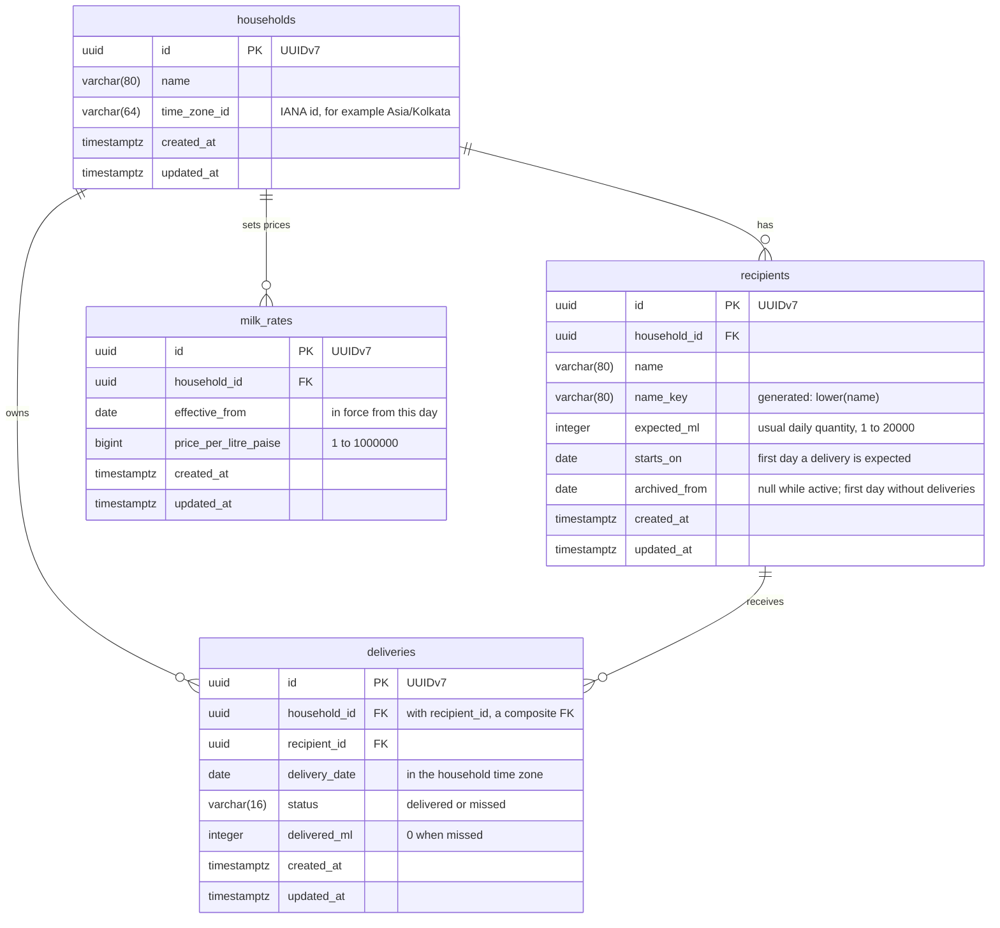
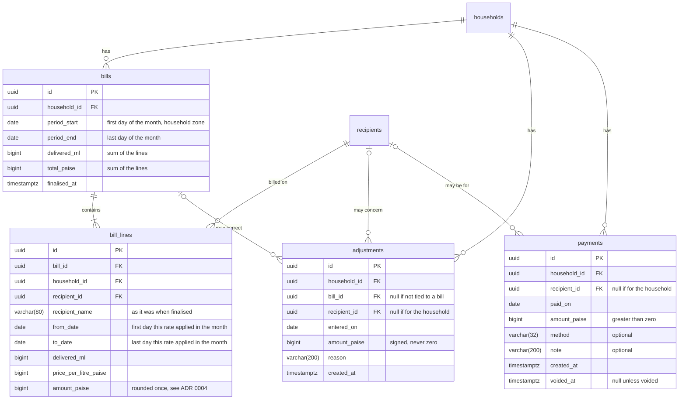

# Domain model

> **Status: proposed.** Nothing on this page is implemented yet. It is the design behind
> [ADR 0004](decisions/0004-domain-model-for-household-deliveries.md), which records why. The
> [slice 1 plan](../plans/slice-1-recipients-and-deliveries.md) says how and when it gets built.

This page covers the model for the first working slice (households, recipients, milk rates and daily
deliveries) and sketches the billing tables that come later, so you can see that the slice-1 tables
do not have to change when billing is added.

## Aggregates and value objects

Four aggregate roots, each with its own repository. All live in `PureFreshMilk.Domain`, which stays
free of any package reference.

| Aggregate | Holds | Notes |
| --- | --- | --- |
| `Household` | Name, time zone id | Owns the notion of "today". In slice 1 there is exactly one. |
| `Recipient` | Name, usual quantity, `starts_on`, `archived_from` | Never deleted. Knows whether it is active on a date. |
| `MilkRate` | Effective-from date, price per litre | `RateSchedule` (a pure type built from a household's rates) answers "which rate applies on this date". |
| `Delivery` | Recipient, date, status, delivered quantity | Unbounded growth, so it is not a child of `Recipient`. |

| Value object | State | Status |
| --- | --- | --- |
| `Quantity` | Whole millilitres, non-negative | Exists ([ADR 0002](decisions/0002-quantities-in-whole-millilitres.md)) |
| `PricePerLitre` | Whole paise per litre, 1 to 1,000,000 | New in the first pull request |
| `Money` | Signed whole paise, checked arithmetic | New with billing |
| `HouseholdId`, `RecipientId`, `MilkRateId`, `DeliveryId` | A UUIDv7 each | New, one per aggregate |
| `DeliveryStatus` | `Delivered` or `Missed` | New in the second pull request |

Dates are `DateOnly`. There is no wrapper type.

Relationships: a household has many recipients, many rates and many deliveries; a recipient has many
deliveries. A delivery belongs to a recipient *and* carries the household's id, and the database
requires the two to agree.

## Tables for slice 1

Planned PostgreSQL tables. Types are PostgreSQL types. `households`, `recipients` and `milk_rates`
arrive with the first pull request and `deliveries` with the second.

### Constraints and indexes

The diagram cannot show composite keys, checks or indexes, so they are listed here.

| Table | Constraint or index | Why |
| --- | --- | --- |
| `households` | `CHECK (length(btrim(name)) BETWEEN 1 AND 80)` | No blank names. |
| `recipients` | `UNIQUE (household_id, id)` | The target for composite foreign keys from child tables. |
| `recipients` | `FK household_id → households (id)`, `ON DELETE RESTRICT` | History must outlive any deletion attempt. |
| `recipients` | `CHECK (expected_ml BETWEEN 1 AND 20000)` | A sane daily quantity. |
| `recipients` | `CHECK (archived_from IS NULL OR archived_from > starts_on)` | A recipient is active for at least one day. |
| `recipients` | `CHECK (length(btrim(name)) BETWEEN 1 AND 80)` | No blank names. |
| `recipients` | `UNIQUE (household_id, name_key) WHERE archived_from IS NULL` | Active names are unique, ignoring case. `name_key` is a stored generated column; archived names can be reused. |
| `milk_rates` | `FK household_id → households (id)`, `ON DELETE RESTRICT` | |
| `milk_rates` | `UNIQUE (household_id, effective_from)` | One price per household per start date. |
| `milk_rates` | `CHECK (price_per_litre_paise BETWEEN 1 AND 1000000)` | Positive, and small enough that amounts cannot overflow. |
| `deliveries` | `FK (household_id, recipient_id) → recipients (household_id, id)`, `ON DELETE RESTRICT` | A delivery cannot point at another household's recipient. |
| `deliveries` | `UNIQUE (recipient_id, delivery_date)` | One delivery per recipient per day. Also serves per-recipient date ranges. |
| `deliveries` | `INDEX (household_id, delivery_date)` | The day sheet and every history range filter on exactly these two columns. |
| `deliveries` | `CHECK (status IN ('delivered', 'missed'))` | Status as text, readable in SQL. |
| `deliveries` | `CHECK ((status = 'delivered' AND delivered_ml BETWEEN 1 AND 20000) OR (status = 'missed' AND delivered_ml = 0))` | The quantity matches the status. |

There are no other secondary indexes. The tables are small; add an index when a real query needs one.

The rule "a delivery date cannot be after today" depends on the household's time zone, so it is
enforced by the Application, not by a `CHECK`.

## Billing tables (planned, not built in slice 1)

Shown so that the model is judged complete. None of these tables exists in either pull request of
the slice. Every table carries `household_id`, and references use composite keys like the ones above.

A **bill** exists only once it is finalised. Before that, the month's figures are calculated from
deliveries and rates on request. A **balance** is never stored: it is the sum of finalised bills and
adjustments, minus payments that are not voided. `households` and `recipients` appear below without
columns; they are the tables defined above.

Why the slice-1 tables fit this without change:

- Deliveries hold facts only (date and millilitres), so no money column ever has to be added to them
  or rewritten.
- Rates are effective-dated, so a bill line can be derived for any period, and a line's own price is
  copied into `bill_lines` when the bill is finalised.
- The household's time zone defines month boundaries, so periods need no extra data.
- `starts_on` and `archived_from` say which days a delivery was expected, which is what "unrecorded
  days" in a month means.
- `bills` has one row per household and month (`UNIQUE (household_id, period_start)`). If each
  recipient turns out to be billed separately, that is the one place a column has to be added, which
  is why the question is listed before billing starts.

### Worked examples for the rounding rule

Rates are in paise per litre. `amount = round_half_up(delivered_ml × price ÷ 1000)`.

| Case | Calculation | Result |
| --- | --- | --- |
| One delivery of 250 ml at ₹62.50 (6,250) | 250 × 6,250 ÷ 1,000 = 1,562.5 | 1,563 paise |
| 30 days of 250 ml at ₹62.50, rounded once | 7,500 × 6,250 ÷ 1,000 | 46,875 paise (₹468.75) |
| The same, rounded per delivery (rejected) | 30 × 1,563 | 46,890 paise (15 paise too much) |
| Rate change on 15 October, 1 L a day: ₹60.00 to 14 October, ₹64.00 from 15 October | 14,000 × 6,000 ÷ 1,000 + 17,000 × 6,400 ÷ 1,000 = 84,000 + 108,800 | 192,800 paise (₹1,928.00), as two lines |

## Invariants that need tests

Each rule below needs a test before the pull request that introduces it can merge. The level says
where the test belongs:

- **D**: a Domain unit test, with no framework and no database.
- **A**: an Application handler test, using in-memory repositories.
- **I**: an integration test against real PostgreSQL (the database checks cannot be tested any other
  way).
- **API**: a contract test through the in-memory HTTP pipeline.

Rules already covered by `QuantityTests` (non-negative, whole millilitres, checked addition) are not
repeated.

### Household

| ID | Rule | Level | PR |
| --- | --- | --- | --- |
| H-1 | The name is trimmed and has 1 to 80 characters. | D | A |
| H-2 | The time zone must be a valid IANA id; an unknown id is rejected. | D | A |
| H-3 | `Today(utcNow)` uses the household's zone. At 18:29 UTC on 30 Oct 2026 it is 30 Oct in `Asia/Kolkata`; at 18:30 UTC it is 31 Oct. | D | A |
| H-4 | `Asia/Kolkata` resolves on every platform CI runs on, so missing time zone data fails loudly. | D | A |
| H-5 | Single-household mode never serves more than one household. | A | A |

### Recipient

| ID | Rule | Level | PR |
| --- | --- | --- | --- |
| R-1 | The name is trimmed and has 1 to 80 characters. | D | A |
| R-2 | The usual quantity is 1 to 20,000 ml. | D | A |
| R-3 | The start date is required (the default `DateOnly` is rejected). | D | A |
| R-4 | `IsActiveOn(d)`: false before `starts_on`, true on it, true on the day before `archived_from`, false on `archived_from` and after, always true after `starts_on` when not archived. | D | A |
| R-5 | `Archive(from)` needs `from > starts_on`; archiving an archived recipient is rejected; `Unarchive` clears the date. | D | A |
| R-6 | Archiving needs `archived_from` after the recipient's latest delivery date. | A | B |
| R-7 | Moving `starts_on` later than the earliest delivery is rejected. | A | B |
| R-8 | Active names are unique, ignoring case ("Recipient A" and "recipient a" collide); an archived name can be reused; unarchiving into a taken name is rejected. | A, I | A |
| R-9 | The default list hides archived recipients; `includeArchived` shows them. | A | A |
| R-10 | Changing the usual quantity leaves existing deliveries unchanged. | A | B |

### Milk rate and rate schedule

| ID | Rule | Level | PR |
| --- | --- | --- | --- |
| T-1 | A price is 1 to 1,000,000 paise a litre; zero and negative are rejected. | D | A |
| T-2 | `RateSchedule.RateOn(d)`: no rate before the first; the new rate applies on its effective-from day; the old rate applies the day before; the result does not depend on the order rates were added (back-dating works). | D | A |
| T-3 | A second rate with the same effective-from date is rejected with a conflict. | A, I | A |
| T-4 | A first rate dated in the past is accepted. | A | A |
| T-5 | `in-effect` with no applicable rate answers "none", not zero. | A, API | A |
| T-6 | A rate that governs any date in a finalised bill cannot be changed or deleted. | A | Billing |

### Delivery

| ID | Rule | Level | PR |
| --- | --- | --- | --- |
| L-1 | `delivered` needs at least 1 ml. | D | B |
| L-2 | `missed` has 0 ml; a `missed` request carrying a positive quantity is rejected. | D | B |
| L-3 | A quantity above 20,000 ml is rejected. | D | B |
| L-4 | An omitted quantity copies the recipient's usual quantity into the row. | D | B |
| L-5 | A date after the household's today is rejected; today is accepted. | A | B |
| L-6 | A recipient who is not active on the date is rejected. | D | B |
| L-7 | Recording again replaces the record rather than adding a second. `delivered` → `missed` sets 0 ml; `missed` → `delivered` without a quantity uses the usual quantity. | D, A | B |
| L-8 | Clearing returns the day to `notRecorded`; clearing a day with no record is a no-op. | A | B |
| L-9 | A delivery cannot reference a recipient of another household. | I | B |
| L-10 | Two simultaneous records for the same recipient and day leave exactly one row, and the loser is handled. | I | B |
| L-11 | A recipient with deliveries cannot be deleted. | I | B |
| L-12 | The status and quantity checks reject `(delivered, 0)`, `(missed, 500)` and an unknown status. | I | B |
| L-13 | The day sheet lists the recipients active that day; those without a row are `notRecorded`; the totals add up. | A | B |
| L-14 | "Deliver remaining" touches only `notRecorded` rows, uses each usual quantity, and is atomic. | A, I | B |
| L-15 | A range of more than 366 days, or `from` after `to`, is rejected. | A | B |

### Persistence

| ID | Rule | Level | PR |
| --- | --- | --- | --- |
| P-1 | The migration applies to an empty database, and the model has no changes beyond it. | I | A |
| P-2 | Dates round-trip as `DateOnly` with no shift, and typed ids round-trip. | I | A |
| P-3 | With the global filter (later), a query as one household never returns another's rows. | I | Auth |

### Billing (designed now, tested when built)

| ID | Rule | Level |
| --- | --- | --- |
| B-1 | Month boundaries follow the household zone, including a delivery near midnight. | D |
| B-2 | A month with a rate change splits into one line per rate (the 192,800 paise example above). | D |
| B-3 | Rounding happens once per line (the 46,875 paise example above), with exact midpoints rounding up. | D |
| B-4 | Arithmetic is checked; overflow throws. | D |
| B-5 | Finalising a month with delivered milk on an unpriced date is refused. | A |
| B-6 | Finalising the same month twice is rejected. | A |
| B-7 | A finalised bill does not change when a rate, a recipient or a delivery is changed later. | A, I |
| B-8 | Changing or clearing a delivery in a finalised month is rejected. | A |
| B-9 | Balance = bills + adjustments − non-voided payments, whatever order they were entered in. | D |
| B-10 | A payment is greater than zero; an adjustment is not zero and has a reason. | D |
