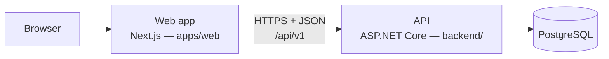
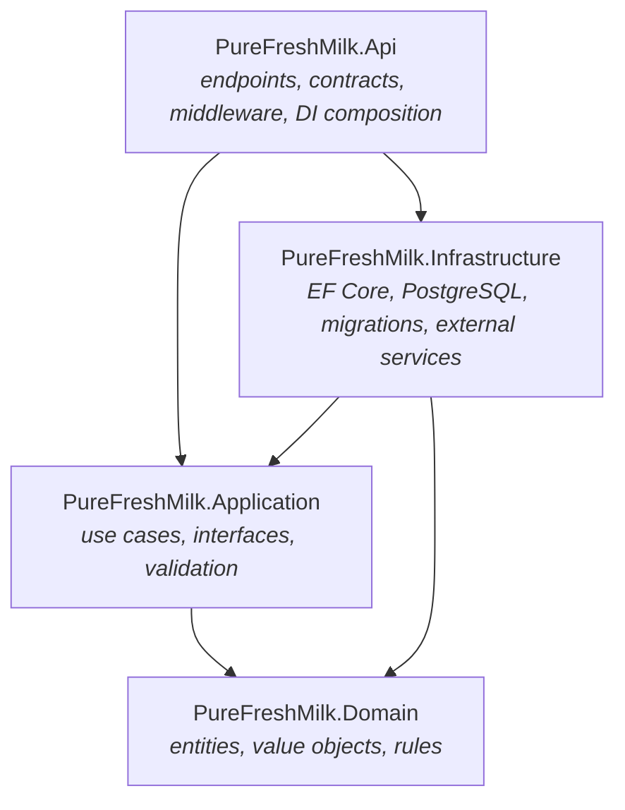

# Architecture overview

PureFreshMilk records a household's daily milk deliveries. It will later work out charges,
payments and outstanding balances. This document describes how the code is organised and the rules
that keep it that way. Decisions and their reasoning are recorded as
[architecture decision records](decisions/README.md).

**Current phase: slice 1, first half.** Households, recipients and milk rates are persisted and
served by the API, and the Recipients and Settings screens use them. Daily deliveries, billing and
authentication do not exist yet, and Today and History still run on demo data. See
[What is not implemented yet](#what-is-not-implemented-yet).

## System context



- One web app and one API. No microservices, no GraphQL, no second backend.
- The web app reaches the API only through its service layer (`apps/web/src/services`).
- The API is the single source of truth for persisted data and for every calculation involving
  money or totals (see [Data and API boundaries](#data-and-api-boundaries)).

## Backend: Onion Architecture

The solution `backend/PureFreshMilk.slnx` has four projects. Dependencies point **inwards only**:



| Project | Contains | May reference | Must not reference |
| --- | --- | --- | --- |
| `PureFreshMilk.Domain` | Entities, value objects (e.g. `Quantity`), enums, business rules, `DomainException` | Nothing (base class library only) | Any other project, ASP.NET Core, EF Core, Npgsql, HTTP or database libraries |
| `PureFreshMilk.Application` | Use-case handlers, interfaces that Infrastructure implements, validation, orchestration | Domain; `Microsoft.Extensions.DependencyInjection.Abstractions` | Infrastructure, Api, ASP.NET Core, EF Core, Npgsql |
| `PureFreshMilk.Infrastructure` | `PureFreshMilkDbContext`, entity configurations, migrations, repository implementations, external services | Application, Domain | Api |
| `PureFreshMilk.Api` | Minimal-API endpoints, request/response DTOs, middleware, configuration, DI wiring | Application, Infrastructure | — |

### How the rules are enforced

1. **Project references.** A layer cannot use a type from a project it does not reference.
   Because project references can't be circular, the compiler also stops inner layers reaching outwards.
2. **Internal persistence.** `PureFreshMilkDbContext` and future repositories are `internal` to
   Infrastructure. The Api references Infrastructure only to call `AddInfrastructure(...)`, so
   endpoints *cannot* query the database directly; they must go through an Application use case.
3. **Architecture tests** (`backend/tests/PureFreshMilk.ArchitectureTests`) fail the build in CI if:
   - any `.csproj` gains a `ProjectReference` outside the allowed graph above,
   - Domain gains any package reference, or its compiled assembly references anything beyond the BCL,
   - the Application assembly references Infrastructure, Api, ASP.NET Core, EF Core or Npgsql,
   - the Infrastructure assembly references the Api,
   - Infrastructure exposes a public `DbContext`.

   These tests were checked by deliberately breaking each rule and confirming the test fails.

Changing an allowed reference is an architectural decision: update the test *and* add an ADR.

### Request flow

`GET /api/v1/status` is the walking skeleton that every future feature follows:

```text
HTTP request
  → Api/Features/Status/StatusEndpoints        (routing, maps result to StatusResponse DTO)
  → Application/Status/GetSystemStatusHandler  (the use case)
  → returns SystemStatus                        (application result, not an HTTP type)
  → 200 OK { service, version, serverTime }
```

Endpoints stay thin: they bind the request, call one handler and map the result to a response
DTO. Business calculations belong in Domain or Application, never in an endpoint.

### Conventions for new backend code

- **Feature folders.** Group by feature (`Features/Deliveries/…`), not by technical type.
- **Use cases** are plain classes (`XxxHandler`) registered in `AddApplication()`. There is no
  mediator library.
- **Contracts.** Each endpoint has explicit request/response records in its Api feature folder.
  Domain entities are never serialised directly.
- **Errors.** Unhandled exceptions and status codes become RFC 9457 Problem Details
  (`AddProblemDetails`, `UseExceptionHandler`, `UseStatusCodePages`).
- **Persistence.** For the first persisted entity:
  1. Model it in Domain.
  2. Add an `IEntityTypeConfiguration<T>` under `Infrastructure/Persistence/Configurations/`.
  3. Call `modelBuilder.ApplyConfigurationsFromAssembly(...)` in `PureFreshMilkDbContext.OnModelCreating`.
     This was left out deliberately while there are no configurations, because EF Core logs a warning when it finds none.
  4. Expose it through an interface declared in Application and implemented (internally) in Infrastructure.
  5. Add a migration (commands in [development.md](../development.md#database-migrations)).
- **Time.** Use the injected `TimeProvider`, never `DateTime.Now`, so behaviour is testable.

### Health checks

| Endpoint | Meaning | Checks |
| --- | --- | --- |
| `GET /health/live` | The process is running | None |
| `GET /health/ready` | The API can serve traffic | PostgreSQL connection (EF Core `CanConnectAsync`) and no pending migrations |

The API fails at start-up with a clear message if `ConnectionStrings:PureFreshMilk` is missing.

## Data and API boundaries

- **Versioned REST API** under `/api/v1`. Breaking changes get a new version group.
- **Explicit DTOs** on both sides. The TypeScript types in `apps/web/src/types/api.ts` mirror the
  Api response records by hand. There is deliberately no shared .NET/TypeScript package.
  Generating the client from the OpenAPI document (`/openapi/v1.json` in Development) is an
  option for later.
- **Server-authoritative calculations.** Delivered quantities, charges, payments and balances
  are calculated by the API. The web app displays results; it never computes a bill.
  The Today prototype sums demo quantities on the client only because nothing is persisted yet.
  This is marked in `features/today/today-state.ts`.
- **Quantities** are whole millilitres everywhere: Domain `Quantity`, database columns, DTOs and
  the web app. There is no floating-point volume arithmetic ([ADR 0002](decisions/0002-quantities-in-whole-millilitres.md)).
- **Household isolation (planned).** Every household-owned row will carry a `HouseholdId`. The
  current household will come from the authenticated user through an Application abstraction.
  Infrastructure will apply it as an EF Core global query filter, so a query can't accidentally read
  another household's data. Isolation will have dedicated integration tests.
- **Authentication (planned)** arrives in a later phase. Until then there are no accounts, and the
  login/sign-up screens are disabled previews.

## Frontend

`apps/web` is a Next.js App Router app (TypeScript strict, Tailwind CSS 4).

```text
src/
  app/                 Routes and layouts only — thin, compose feature components
    (marketing)/       /                      landing page
    (auth)/            /login, /signup        disabled previews
    app/               /app/*                 application shell (sidebar / bottom tabs)
  components/ui/       Reusable, accessible primitives (Button, Card, Badge, TextField, …)
  components/layout/   App shell, navigation, headers, footers
  features/<name>/     Feature UI and its state (today, landing, auth, settings, recipients)
  services/            The only code that calls the API (api-client.ts + one module per resource)
  lib/                 Framework-free helpers (formatting, demo data, class names)
  types/               Shared types: household model and API response shapes
tests/
  unit/                Vitest + Testing Library
  e2e/                 Playwright: every route, 360px overflow, axe accessibility, Today flow
```

Rules:

- Route files stay small; screens live in `features/`.
- Components never call `fetch`. They call a function in `services/`.
- Logic sits in plain TypeScript modules (for example `today-state.ts`), not inside components,
  so it can be unit-tested.
- **Demo data** lives in `lib/demo-household.ts` and must be labelled "Demo data" wherever it is shown.
  It is never presented as stored data.
- Design tokens (colours, radii, shadows, fonts) are defined once in `src/app/globals.css`.
  Components use the semantic names (`bg-surface`, `text-ink-muted`, `bg-accent`, …).
- Accessibility is tested, not assumed: semantic landmarks, visible focus, 44px touch targets,
  `prefers-reduced-motion`, and axe checks in CI.

## What is not implemented yet

The model for slice 1 (households, recipients, milk rates and daily deliveries) is proposed in
[ADR 0004](decisions/0004-domain-model-for-household-deliveries.md), with the tables and the
invariants that need tests in [Domain model](domain-model.md) and the build order in the
[slice 1 plan](../plans/slice-1-recipients-and-deliveries.md). Households, recipients and milk rates
(PR A) are built; daily deliveries (PR B) are not.

| Area | State |
| --- | --- |
| Persistence | Households, recipients and milk rates are mapped, with one migration (`AddHouseholdsRecipientsAndMilkRates`). Deliveries are designed, not built. |
| Recipients and the milk price | Built: API endpoints under `/api/v1` and the Recipients and Settings screens. Without an API address those screens show labelled demo data or say they need the API. |
| Deliveries, Today, history, month view | Today runs on demo data, History and Month are placeholders. No delivery endpoints. |
| Billing: prices, charges, payments, balances | Not started. Will be server-side only. Money is designed as whole paise in ADR 0004. |
| Authentication | Not started. Login and sign-up are disabled previews. Until it exists the data endpoints run in single-household mode with no login: they are mapped only in Development and Testing, or when `Access__AllowUnauthenticated=true` is set. |
| Household data isolation | Designed (above). Tables carry `household_id` and the parent key that composite foreign keys will use; the query filter and the isolation tests wait for authentication. |
| Deployment, TLS termination, forwarded headers, rate limiting | Not decided. No hosting target yet. |
| Dark mode, localisation | Not started. |
